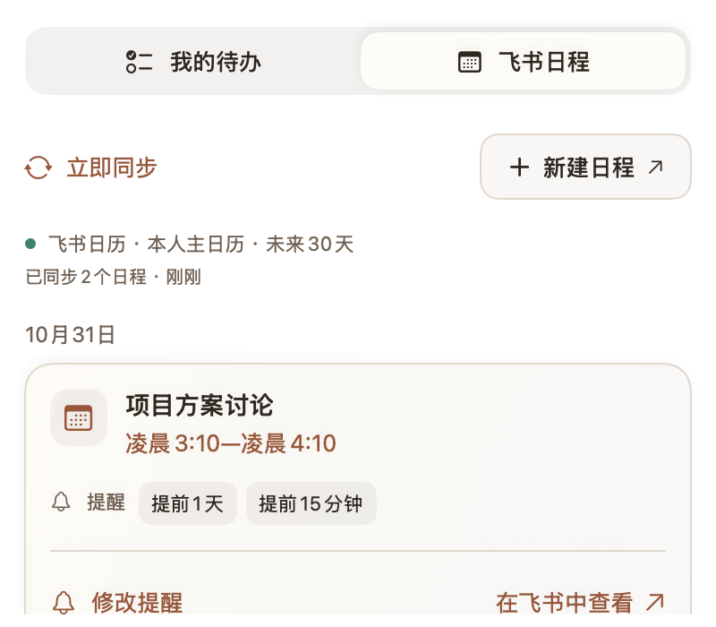

# build82 修复工作记录

基线：aac90af6d50a40e75a3fc0c8bba985c8e9e88be1，0.10.0 build82。
本轮只在开发分支修复，完成验证后安装到宰治本机；不自动合并 main。

## 用户要求与验收

- [x] 消息接收约 20 秒延迟：降低轮询阻塞，保留身份、未读和免打扰保护；合成延迟与真实送达分别记录。
- [x] 打开飞书会话导致小岛退出：修复回调线程，验证后台回调及失败路径。
- [x] 待办编辑日期不显示年份；历史保留记录的日期时间。
- [x] 飞书日程删除或结束后消失；完整同步成功才能替换快照，失败不能误删。
- [x] 岛内移除快捷打开入口，只保留个人卡片；隐藏创建人、创建时间等展示元信息，原始数据保留。
- [x] WorkBuddy 收起内容适配内屏刘海宽度；展开动画连贯。
- [x] 联系人右侧换成可读的提醒方式按钮，三种规则含义不变。
- [x] 弹幕配色面板适配与即时预览；岛内最近消息不继承弹幕皮肤。
- [x] 完成记录可折叠、限定高度、可滚动。
- [x] 完整展开模式悬停直接展开；先露胶囊模式保持两阶段；消除收起时白边。
- [x] 弹幕启用后可显示，长文分页完整。
- [x] 新增：首次连接只需点连接飞书、在飞书同意、自动返回同步。不要求普通用户创建应用或选择本机配置。消息与日程用途分别授权，日程只读。

## 边界

- 不记录真实消息正文，不改已读，不发送消息；测试仅合成数据。
- 安装前备份应用及受影响本机数据；不退出飞书，不新增登录项。
- 原生 UI、真实新消息及内屏悬停体验必须分别验收，构建通过不能替代。
- 既有统一授权服务仍在线。build82 把入口改为本机 CLI；恢复直接授权需核对服务日程权限合同，不得把旧的读写令牌标成只读。

## 当前发现

- 飞书打开会话回调用了 MainActor.assumeIsolated，系统不保证回调线程。
- 日程快照保留 removed 项，而列表没有排除；时间到期也不主动触发列表刷新。
- 接收每个业务调用前后都另起 CLI 核对身份，快查按整批等待；正在保留身份保护前提下修复调度。

## 交付事实（2026-10-29）

- 本机已安装 0.10.1 build83，保留原路径 `~/Applications/一切在岛.app`、旧别名和既有启动项；旧 build82 与应用数据、7 份偏好文件已保存于本工作副本 `.build/local-install-backups/build83-20261029-011151`（位于 apps/island）。没有退出飞书或新增启动项。
- 启动后原消息账号恢复接收。安装前后工作项、完成记录、回收站、配方及所选卡片逐项相同。日历连接后只新增本人日程同步状态；未提交任何本机材料、日历内容、聊天或凭据。
- 点击日历「连接飞书」直接打开官方确认页。本次请求仅「读取日历信息」「读取日程信息」，沿用本人已有授权；客户端实际取得精确只读 scope 后同步成功，手动「立即同步」再次成功。无需创建应用或选择本机配置。
- 用户已明确批准发布只读日历授权更新。现有 feishu-island.virxact.net 发布 554 live，运行正常、无重启及 OOM；只替换 core.cjs，18 个公开资源与上一版逐文件一致。作者和全公司访问范围不变，现有下载包未更新。旧部署 429 及原发布目录保留可回退。

## 验证结果

在兼容的 macOS 26.4 SDK 下使用 `swift run --disable-sandbox -j 2 --sdk "$ISLAND_SDK"`：

| 检查 | 结果 | 证明范围 |
| --- | --- | --- |
| UnifiedProductChecks --skin-preview --render .build/build83-native-checks | 414 通过 | 原生多尺寸/明暗界面、授权 WebKit 桥、只读日历用途、历史记录、长文完整性、会话打开成功/失败的后台回调 |
| FusionChecks --skin-preview | 1158 通过 | 合成接收、过滤、未读保护、长短弹幕、取消和状态恢复；窗口不显示 |
| SurfaceInteractionChecks .build/build83-surface-checks --skin-preview | 111 通过，0 项输入场景受阻 | 原生展开/收回、输入和菜单期间保持展开、内外屏几何、WorkBuddy 长状态适配 180pt 刘海 |
| UnifiedFeishuChecks --skin-preview | 69 通过 | 消息模块合成检查，无真实账号调用 |
| node --test AuthService/*.test.cjs | 32 通过 | 用途隔离、精确权限、较宽旧授权通过官方接口收窄、保存失败、取消和实际静态资源 |
| 实际原生 UI 点验 | 通过 | 联系人规则菜单、配色输入/应用与预览、完成记录展开；安装版直接授权、自动日历同步及手动同步 |
| 打包与安装 | 通过 | release 构建、签名校验、版本83；CLI和两个凭据/状态helper与旧版字节一致 |

六个会话各延迟 0.8 秒的合成场景中，新活跃会话在 1.38 秒收到，证明不再等待整批旧会话。此数字不是实际飞书送达延迟。

## 仍需真实使用观察的部分

- 新版连续真实新消息的逐条延迟，以及长时间稳定性；没有发测试消息或把合成数据当真实接收验收。
- 没有创建或删除真实飞书日程；删除、取消和到期移除由完整快照及合成时钟检查验证，真实主日历只读同步已验证。
- 真实物理鼠标悬停观感和断开外屏后的主观顺滑度仍需本人使用观察；原生动画、几何与输入测试已通过。
- 不同同事的首次登录、Intel 设备和跨天授权续期尚未验收。旧历史较宽授权仍由飞书管理，新日历请求及实际给客户端的令牌限制为只读。

以上勾选表示本轮实现并完成相应检查，不代表上述长期/其他账号场景已经实测。开发分支同步不会合并 main；正式源码版本上线仍需两位真实负责人批准同一版本。

## 合成界面预览

